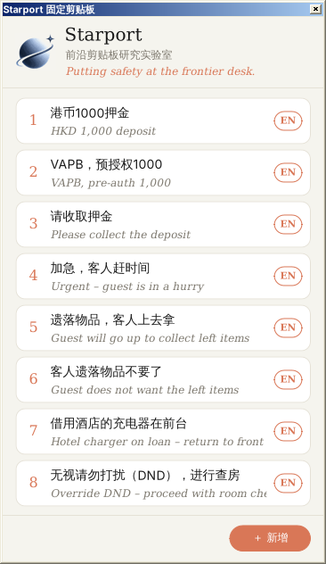

# Starport 固定剪贴板

酒店前台用的 Windows 小工具：常用语一键复制到剪贴板，再到任意软件里 Ctrl+V。



## 功能

- 点卡片复制中文，点右侧 **EN** 复制英文
- 窗口默认置顶，点右上角 📌 可随时切换置顶开关（状态自动保存）；点击卡片或按钮不会抢走目标软件的焦点，点完直接 Ctrl+V
- 数字键 1–9、0 复制对应序号的卡片（0 = 第 10 张，窗口处于激活状态时）
- 列表区最多同时显示 10 张卡片（对应键盘 1–0），超过时露出下一张并渐隐提示，可在列表内滚动；词条总数上限 20 条
- 「＋ 新增」添加词条；点「管理」进入管理模式，点卡片编辑、✕ 删除，点「完成」返回（管理模式下不会误复制）
- 图片暂存区：点底部「扩展上下文窗口」展开参考图区域，可点「粘贴截图」或拖入图片文件（最多 6 张，超出自动移除最旧一张），点缩略图放大查看、点右上角 ✕ 删除或点「清空」全部移除；图片仅存于内存供对照查看，不进剪贴板、不写硬盘
- 用户模式：点右上角 ⚙ 设置后缀（如 `-Mike`），复制时自动加在末尾，界面上不显示
- 日期占位符：词条里写 `{今天}` / `{明天}`（英文栏也可写 `{today}` / `{tomorrow}`），复制和显示时自动换成日期，中文栏为「10月15日」、英文栏为「15 Oct」；设置里可设营业日分界时间（如凌晨 4 点前仍算前一天）
- 数量占位符：词条里写 `{数量}`（英文栏 `{qty}`），卡片上显示为「?」，点击时弹窗询问份数：直接按 1–9 立即复制，回车用上次的数字，Esc 取消；关闭后焦点自动回到原来的软件
- 按使用次数排名：每次复制计数，下次启动时常用的排在前面
- 窗口标题栏显示版本号（如 `v1.6.2`），取自仓库的 `VERSION` 文件
- 单个 exe，约 25 KB，免安装、无需管理员权限、不联网、不写注册表

## 下载

到 [Releases](../../releases/latest) 下载 `FixedClipboard.exe`，放进任意文件夹双击运行。

需要 .NET Framework 4.x，Windows 10/11 已自带。首次运行若被 SmartScreen 拦截，点「更多信息 → 仍要运行」。

## 词条文件

首次运行会在 exe 同目录生成**隐藏的** `phrases.txt`（UTF-8），文件夹里看起来只有 exe；复制整个文件夹即可连同词条一起带走。每行一条：

```
中文|English|点击次数
```

英文和次数都可以省略。开头以 `#` 开头的几行是设置（用户模式、后缀、营业日分界等），一般在程序的 ⚙ 设置里修改即可。要手动编辑时，在资源管理器里打开「显示隐藏的项目」，用记事本修改后重启程序生效。

## 自己编译

不需要安装任何工具，Windows 自带的 C# 编译器就够了。把仓库下载到本地，双击 `build.bat`，或在 cmd 里运行：

```bat
%WINDIR%\Microsoft.NET\Framework64\v4.0.30319\csc.exe /nologo /target:winexe /optimize+ /codepage:65001 /win32icon:app.ico /resource:logo.png,logo.png /resource:VERSION,version.txt /out:FixedClipboard.exe /r:System.dll /r:System.Drawing.dll /r:System.Windows.Forms.dll FixedClipboard.cs
```

每次推送到 `main`，GitHub Actions 都会在 Windows 上编译一次；修改 `VERSION` 文件里的版本号并推送，会自动发布对应的 Release（如 `v1.0.1`）。
